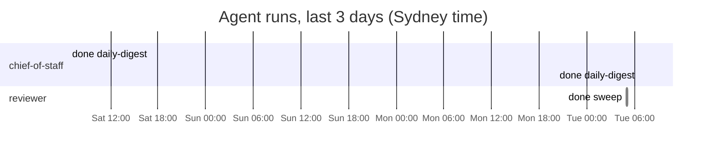

Updated Tue 10 Nov 2026 06:37 Sydney

# RUNNING

## Agents

| | Agent | Owner | State | Current or last task | Last run start (Sydney) | Minutes | Next run (Sydney) | Open pull requests |
|---|---|---|---|---|---|---|---|---|
| 🟡 | chief-of-staff | Adam | waiting on human | daily-digest | Tue 10 Nov 06:35 | 3 | Wed 11 Nov 06:30 | [#26](https://github.com/roulmediateam-byte/fifteen-expert-hq/issues/26), [#25](https://github.com/roulmediateam-byte/fifteen-expert-hq/issues/25), [#23](https://github.com/roulmediateam-byte/fifteen-expert-hq/issues/23), [#20](https://github.com/roulmediateam-byte/fifteen-expert-hq/issues/20) |
| 🔴 | design | Adam | overdue | pick-work | Sat 7 Nov 01:08 | 2 | Wed 11 Nov 01:00 | [#19](https://github.com/roulmediateam-byte/fifteen-expert-hq/issues/19), [#12](https://github.com/roulmediateam-byte/fifteen-expert-hq/issues/12) |
| 🔴 | engineer | Adam | overdue | pick-work | Sat 7 Nov 02:15 | 4 | Wed 11 Nov 02:00 | [#22](https://github.com/roulmediateam-byte/fifteen-expert-hq/issues/22), [#21](https://github.com/roulmediateam-byte/fifteen-expert-hq/issues/21), [#18](https://github.com/roulmediateam-byte/fifteen-expert-hq/issues/18) |
| 🟢 | reviewer | Adam | done | sweep | Tue 10 Nov 05:04 | 3 | Wed 11 Nov 05:00 sweep, and on every pull request | none |
| 🔴 | research | Adam | overdue | none | never |  | Mon 16 Nov 03:00 | none |
| ⚪ | sales | Melvin | off | none | never |  | off (off until phase 5) | none |

## Waiting on you

**Adam**

- Nothing waiting.

**Melvin**

- [#12](https://github.com/roulmediateam-byte/fifteen-expert-hq/issues/12) [design] Build the one-page website (pull request, 131 hours)
- [#20](https://github.com/roulmediateam-byte/fifteen-expert-hq/issues/20) [chief-of-staff] Digest 2026-11-05 (pull request, 115 hours)
- [#19](https://github.com/roulmediateam-byte/fifteen-expert-hq/issues/19) [design] Add the page checklist (pull request, 115 hours)
- [#18](https://github.com/roulmediateam-byte/fifteen-expert-hq/issues/18) [engineer] Add a first passing smoke test in prototype/ (pull request, 115 hours)
- [#21](https://github.com/roulmediateam-byte/fifteen-expert-hq/issues/21) [engineer] Worker console demo (made-up claims) (pull request, 114 hours)
- [#22](https://github.com/roulmediateam-byte/fifteen-expert-hq/issues/22) [engineer] Client portal demo (made-up claims) (pull request, 113 hours)
- [#23](https://github.com/roulmediateam-byte/fifteen-expert-hq/issues/23) [chief-of-staff] Digest 2026-11-06 (pull request, 95 hours)
- [#24](https://github.com/roulmediateam-byte/fifteen-expert-hq/issues/24) [setup] Adopt a reviewed part of ECC for the agents (pull request, 78 hours)
- [#25](https://github.com/roulmediateam-byte/fifteen-expert-hq/issues/25) [chief-of-staff] Digest 2026-11-07 (pull request, 71 hours)
- [#26](https://github.com/roulmediateam-byte/fifteen-expert-hq/issues/26) [chief-of-staff] Digest 2026-11-10 (pull request, 0 hours)

## Timeline

## Board

| Label | Open Issues |
|---|---|
| agent:chief-of-staff | 0 |
| agent:design | 1 |
| agent:engineer | 1 |
| agent:reviewer | 0 |
| agent:research | 0 |
| agent:sales | 0 |
| human:adam | 0 |
| human:melvin | 0 |

Issues closed in the last 7 days: 0.

## Alerts

- 🔴 design is overdue: no heartbeat since the Tue 10 Nov 01:00 run
- 🔴 engineer is overdue: no heartbeat since the Tue 10 Nov 02:00 run
- 🔴 research is overdue: no heartbeat since the Mon 9 Nov 03:00 run
- 🔴 [#25](https://github.com/roulmediateam-byte/fifteen-expert-hq/issues/25) has been open 71 hours: [chief-of-staff] Digest 2026-11-07
- 🔴 [#24](https://github.com/roulmediateam-byte/fifteen-expert-hq/issues/24) has been open 78 hours: [setup] Adopt a reviewed part of ECC for the agents
- 🔴 [#23](https://github.com/roulmediateam-byte/fifteen-expert-hq/issues/23) has been open 95 hours: [chief-of-staff] Digest 2026-11-06
- 🔴 [#22](https://github.com/roulmediateam-byte/fifteen-expert-hq/issues/22) has been open 113 hours: [engineer] Client portal demo (made-up claims)
- 🔴 [#21](https://github.com/roulmediateam-byte/fifteen-expert-hq/issues/21) has been open 114 hours: [engineer] Worker console demo (made-up claims)
- 🔴 [#20](https://github.com/roulmediateam-byte/fifteen-expert-hq/issues/20) has been open 115 hours: [chief-of-staff] Digest 2026-11-05
- 🔴 [#19](https://github.com/roulmediateam-byte/fifteen-expert-hq/issues/19) has been open 115 hours: [design] Add the page checklist
- 🔴 [#18](https://github.com/roulmediateam-byte/fifteen-expert-hq/issues/18) has been open 115 hours: [engineer] Add a first passing smoke test in prototype/
- 🔴 [#12](https://github.com/roulmediateam-byte/fifteen-expert-hq/issues/12) has been open 131 hours: [design] Build the one-page website
- 🔴 [#12](https://github.com/roulmediateam-byte/fifteen-expert-hq/issues/12) from design changes files outside its folders: PROJECT_STATE.md, ops/links.md

---
Built by .github/workflows/mission-control.yml. Usage of the Max plan is not visible here: check claude.ai/settings/usage on Mondays. Do not edit this Issue by hand: it is rewritten every hour and after every heartbeat.
