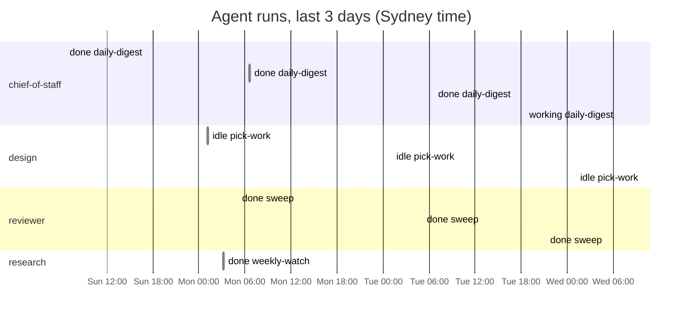

Updated Wed 25 Nov 2026 06:35 Sydney

# RUNNING

## Agents

| | Agent | Owner | State | Current or last task | Last run start (Sydney) | Minutes | Next run (Sydney) | Open pull requests |
|---|---|---|---|---|---|---|---|---|
| 🟢 | chief-of-staff | Adam | working | daily-digest | Wed 25 Nov 06:34 | 0 so far | Thu 26 Nov 06:30 | [#41](https://github.com/roulmediateam-byte/fifteen-expert-hq/issues/41), [#40](https://github.com/roulmediateam-byte/fifteen-expert-hq/issues/40), [#38](https://github.com/roulmediateam-byte/fifteen-expert-hq/issues/38), [#37](https://github.com/roulmediateam-byte/fifteen-expert-hq/issues/37), [#36](https://github.com/roulmediateam-byte/fifteen-expert-hq/issues/36), [#35](https://github.com/roulmediateam-byte/fifteen-expert-hq/issues/35), [#34](https://github.com/roulmediateam-byte/fifteen-expert-hq/issues/34), [#33](https://github.com/roulmediateam-byte/fifteen-expert-hq/issues/33), [#32](https://github.com/roulmediateam-byte/fifteen-expert-hq/issues/32), [#30](https://github.com/roulmediateam-byte/fifteen-expert-hq/issues/30), [#29](https://github.com/roulmediateam-byte/fifteen-expert-hq/issues/29), [#28](https://github.com/roulmediateam-byte/fifteen-expert-hq/issues/28), [#27](https://github.com/roulmediateam-byte/fifteen-expert-hq/issues/27), [#26](https://github.com/roulmediateam-byte/fifteen-expert-hq/issues/26), [#25](https://github.com/roulmediateam-byte/fifteen-expert-hq/issues/25), [#23](https://github.com/roulmediateam-byte/fifteen-expert-hq/issues/23), [#20](https://github.com/roulmediateam-byte/fifteen-expert-hq/issues/20) |
| 🟡 | design | Adam | waiting on human | pick-work | Wed 25 Nov 01:09 | 3 | Thu 26 Nov 01:00 | [#19](https://github.com/roulmediateam-byte/fifteen-expert-hq/issues/19), [#12](https://github.com/roulmediateam-byte/fifteen-expert-hq/issues/12) |
| 🔴 | engineer | Adam | overdue | pick-work | Sat 7 Nov 02:15 | 4 | Thu 26 Nov 02:00 | [#22](https://github.com/roulmediateam-byte/fifteen-expert-hq/issues/22), [#21](https://github.com/roulmediateam-byte/fifteen-expert-hq/issues/21), [#18](https://github.com/roulmediateam-byte/fifteen-expert-hq/issues/18) |
| 🟢 | reviewer | Adam | done | sweep | Wed 25 Nov 05:04 | 4 | Thu 26 Nov 05:00 sweep, and on every pull request | none |
| 🟡 | research | Adam | waiting on human | weekly-watch | Mon 23 Nov 03:10 | 8 | Mon 30 Nov 03:00 | [#39](https://github.com/roulmediateam-byte/fifteen-expert-hq/issues/39), [#31](https://github.com/roulmediateam-byte/fifteen-expert-hq/issues/31) |
| ⚪ | sales | Melvin | off | none | never |  | off (off until phase 5) | none |

## Waiting on you

**Adam**

- [#31](https://github.com/roulmediateam-byte/fifteen-expert-hq/issues/31) [research] Weekly watch 2026-11-16 and first watch list (pull request, 219 hours)

**Melvin**

- [#12](https://github.com/roulmediateam-byte/fifteen-expert-hq/issues/12) [design] Build the one-page website (pull request, 491 hours)
- [#20](https://github.com/roulmediateam-byte/fifteen-expert-hq/issues/20) [chief-of-staff] Digest 2026-11-05 (pull request, 475 hours)
- [#19](https://github.com/roulmediateam-byte/fifteen-expert-hq/issues/19) [design] Add the page checklist (pull request, 475 hours)
- [#18](https://github.com/roulmediateam-byte/fifteen-expert-hq/issues/18) [engineer] Add a first passing smoke test in prototype/ (pull request, 475 hours)
- [#21](https://github.com/roulmediateam-byte/fifteen-expert-hq/issues/21) [engineer] Worker console demo (made-up claims) (pull request, 474 hours)
- [#22](https://github.com/roulmediateam-byte/fifteen-expert-hq/issues/22) [engineer] Client portal demo (made-up claims) (pull request, 472 hours)
- [#23](https://github.com/roulmediateam-byte/fifteen-expert-hq/issues/23) [chief-of-staff] Digest 2026-11-06 (pull request, 455 hours)
- [#24](https://github.com/roulmediateam-byte/fifteen-expert-hq/issues/24) [setup] Adopt a reviewed part of ECC for the agents (pull request, 438 hours)
- [#25](https://github.com/roulmediateam-byte/fifteen-expert-hq/issues/25) [chief-of-staff] Digest 2026-11-07 (pull request, 431 hours)
- [#26](https://github.com/roulmediateam-byte/fifteen-expert-hq/issues/26) [chief-of-staff] Digest 2026-11-10 (pull request, 359 hours)
- [#27](https://github.com/roulmediateam-byte/fifteen-expert-hq/issues/27) [chief-of-staff] Digest 2026-11-12 (pull request, 311 hours)
- [#28](https://github.com/roulmediateam-byte/fifteen-expert-hq/issues/28) [chief-of-staff] Digest 2026-11-13 (pull request, 287 hours)
- [#29](https://github.com/roulmediateam-byte/fifteen-expert-hq/issues/29) [chief-of-staff] Digest 2026-11-14 (pull request, 263 hours)
- [#30](https://github.com/roulmediateam-byte/fifteen-expert-hq/issues/30) [chief-of-staff] Digest 2026-11-15 (pull request, 239 hours)
- [#31](https://github.com/roulmediateam-byte/fifteen-expert-hq/issues/31) [research] Weekly watch 2026-11-16 and first watch list (pull request, 219 hours)
- [#32](https://github.com/roulmediateam-byte/fifteen-expert-hq/issues/32) [chief-of-staff] Digest 2026-11-16 (pull request, 215 hours)
- [#33](https://github.com/roulmediateam-byte/fifteen-expert-hq/issues/33) [chief-of-staff] Digest 2026-11-17 (pull request, 191 hours)
- [#34](https://github.com/roulmediateam-byte/fifteen-expert-hq/issues/34) [chief-of-staff] Digest 2026-11-18 (pull request, 167 hours)
- [#35](https://github.com/roulmediateam-byte/fifteen-expert-hq/issues/35) [chief-of-staff] Digest 2026-11-19 (pull request, 143 hours)
- [#36](https://github.com/roulmediateam-byte/fifteen-expert-hq/issues/36) [chief-of-staff] Digest 2026-11-20 (pull request, 119 hours)
- [#37](https://github.com/roulmediateam-byte/fifteen-expert-hq/issues/37) [chief-of-staff] Digest 2026-11-21 (pull request, 95 hours)
- [#38](https://github.com/roulmediateam-byte/fifteen-expert-hq/issues/38) [chief-of-staff] Digest 2026-11-22 (pull request, 71 hours)
- [#39](https://github.com/roulmediateam-byte/fifteen-expert-hq/issues/39) [research] Weekly watch 2026-11-23 (pull request, 51 hours)
- [#40](https://github.com/roulmediateam-byte/fifteen-expert-hq/issues/40) [chief-of-staff] Digest 2026-11-23 (pull request, 47 hours)
- [#41](https://github.com/roulmediateam-byte/fifteen-expert-hq/issues/41) [chief-of-staff] Digest 2026-11-24 (pull request, 23 hours)

## Timeline

## Board

| Label | Open Issues |
|---|---|
| agent:chief-of-staff | 0 |
| agent:design | 1 |
| agent:engineer | 1 |
| agent:reviewer | 0 |
| agent:research | 0 |
| agent:sales | 0 |
| human:adam | 0 |
| human:melvin | 0 |

Issues closed in the last 7 days: 0.

## Alerts

- 🔴 engineer is overdue: no heartbeat since the Wed 25 Nov 02:00 run
- 🔴 [#39](https://github.com/roulmediateam-byte/fifteen-expert-hq/issues/39) has been open 51 hours: [research] Weekly watch 2026-11-23
- 🔴 [#38](https://github.com/roulmediateam-byte/fifteen-expert-hq/issues/38) has been open 71 hours: [chief-of-staff] Digest 2026-11-22
- 🔴 [#37](https://github.com/roulmediateam-byte/fifteen-expert-hq/issues/37) has been open 95 hours: [chief-of-staff] Digest 2026-11-21
- 🔴 [#36](https://github.com/roulmediateam-byte/fifteen-expert-hq/issues/36) has been open 119 hours: [chief-of-staff] Digest 2026-11-20
- 🔴 [#35](https://github.com/roulmediateam-byte/fifteen-expert-hq/issues/35) has been open 143 hours: [chief-of-staff] Digest 2026-11-19
- 🔴 [#34](https://github.com/roulmediateam-byte/fifteen-expert-hq/issues/34) has been open 167 hours: [chief-of-staff] Digest 2026-11-18
- 🔴 [#33](https://github.com/roulmediateam-byte/fifteen-expert-hq/issues/33) has been open 191 hours: [chief-of-staff] Digest 2026-11-17
- 🔴 [#32](https://github.com/roulmediateam-byte/fifteen-expert-hq/issues/32) has been open 215 hours: [chief-of-staff] Digest 2026-11-16
- 🔴 [#31](https://github.com/roulmediateam-byte/fifteen-expert-hq/issues/31) has been open 219 hours: [research] Weekly watch 2026-11-16 and first watch list
- 🔴 [#30](https://github.com/roulmediateam-byte/fifteen-expert-hq/issues/30) has been open 239 hours: [chief-of-staff] Digest 2026-11-15
- 🔴 [#29](https://github.com/roulmediateam-byte/fifteen-expert-hq/issues/29) has been open 263 hours: [chief-of-staff] Digest 2026-11-14
- 🔴 [#28](https://github.com/roulmediateam-byte/fifteen-expert-hq/issues/28) has been open 287 hours: [chief-of-staff] Digest 2026-11-13
- 🔴 [#27](https://github.com/roulmediateam-byte/fifteen-expert-hq/issues/27) has been open 311 hours: [chief-of-staff] Digest 2026-11-12
- 🔴 [#26](https://github.com/roulmediateam-byte/fifteen-expert-hq/issues/26) has been open 359 hours: [chief-of-staff] Digest 2026-11-10
- 🔴 [#25](https://github.com/roulmediateam-byte/fifteen-expert-hq/issues/25) has been open 431 hours: [chief-of-staff] Digest 2026-11-07
- 🔴 [#24](https://github.com/roulmediateam-byte/fifteen-expert-hq/issues/24) has been open 438 hours: [setup] Adopt a reviewed part of ECC for the agents
- 🔴 [#23](https://github.com/roulmediateam-byte/fifteen-expert-hq/issues/23) has been open 455 hours: [chief-of-staff] Digest 2026-11-06
- 🔴 [#22](https://github.com/roulmediateam-byte/fifteen-expert-hq/issues/22) has been open 472 hours: [engineer] Client portal demo (made-up claims)
- 🔴 [#21](https://github.com/roulmediateam-byte/fifteen-expert-hq/issues/21) has been open 474 hours: [engineer] Worker console demo (made-up claims)
- 🔴 [#20](https://github.com/roulmediateam-byte/fifteen-expert-hq/issues/20) has been open 475 hours: [chief-of-staff] Digest 2026-11-05
- 🔴 [#19](https://github.com/roulmediateam-byte/fifteen-expert-hq/issues/19) has been open 475 hours: [design] Add the page checklist
- 🔴 [#18](https://github.com/roulmediateam-byte/fifteen-expert-hq/issues/18) has been open 475 hours: [engineer] Add a first passing smoke test in prototype/
- 🔴 [#12](https://github.com/roulmediateam-byte/fifteen-expert-hq/issues/12) has been open 491 hours: [design] Build the one-page website
- 🔴 [#12](https://github.com/roulmediateam-byte/fifteen-expert-hq/issues/12) from design changes files outside its folders: PROJECT_STATE.md, ops/links.md

---
Built by .github/workflows/mission-control.yml. Usage of the Max plan is not visible here: check claude.ai/settings/usage on Mondays. Do not edit this Issue by hand: it is rewritten every hour and after every heartbeat.
