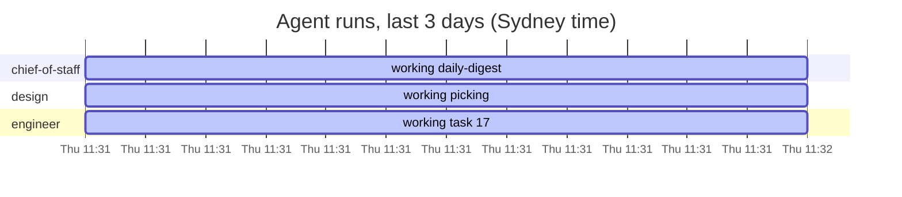

Updated Thu 5 Nov 2026 11:32 Sydney

# RUNNING

## Agents

| | Agent | Owner | State | Current or last task | Last run start (Sydney) | Minutes | Next run (Sydney) | Open pull requests |
|---|---|---|---|---|---|---|---|---|
| 🟢 | chief-of-staff | Adam | working | daily-digest | Thu 5 Nov 11:31 | 0 so far | Fri 6 Nov 06:30 | none |
| 🟢 | design | Adam | working | picking | Thu 5 Nov 11:31 | 0 so far | Fri 6 Nov 01:00 | [#12](https://github.com/roulmediateam-byte/fifteen-expert-hq/issues/12) |
| 🟢 | engineer | Adam | working | [#17](https://github.com/roulmediateam-byte/fifteen-expert-hq/issues/17) | Thu 5 Nov 11:31 | 0 so far | Fri 6 Nov 02:00 | none |
| 🔴 | reviewer | Adam | overdue | none | never |  | Fri 6 Nov 05:00 sweep, and on every pull request | none |
| 🔴 | research | Adam | overdue | none | never |  | Mon 9 Nov 03:00 | none |
| ⚪ | sales | Melvin | off | none | never |  | off (off until phase 5) | none |

## Waiting on you

**Adam**

- Nothing waiting.

**Melvin**

- [#12](https://github.com/roulmediateam-byte/fifteen-expert-hq/issues/12) [design] Build the one-page website (pull request, 16 hours)

## Timeline

## Board

| Label | Open Issues |
|---|---|
| agent:chief-of-staff | 0 |
| agent:design | 1 |
| agent:engineer | 1 |
| agent:reviewer | 0 |
| agent:research | 0 |
| agent:sales | 0 |
| human:adam | 0 |
| human:melvin | 0 |

Issues closed in the last 7 days: 0.

## Alerts

- 🔴 reviewer is overdue: no heartbeat since the Thu 5 Nov 05:00 run
- 🔴 research is overdue: no heartbeat since the Mon 2 Nov 03:00 run
- 🔴 [#12](https://github.com/roulmediateam-byte/fifteen-expert-hq/issues/12) from design changes files outside its folders: PROJECT_STATE.md, ops/links.md

---
Built by .github/workflows/mission-control.yml. Usage of the Max plan is not visible here: check claude.ai/settings/usage on Mondays. Do not edit this Issue by hand: it is rewritten every hour and after every heartbeat.
